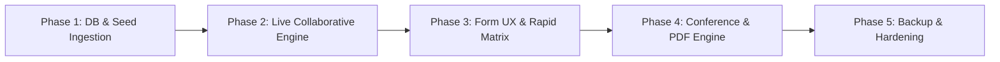

# SMILE — Teacher Collaborative Assessment & Grading Platform
## Comprehensive Implementation Plan & Technical Specification

**Target Environment:** On-premises Proxmox LXC container on school LAN (MS Telfs Dr. Aloys Weissenbach).  
**Initial Cohort:** Grade 2 (Classes 2B, 2F, 2G, 2H) starting with SMILE core subjects (`SD`, `SE`, `SM`).

---

## 1. Executive Summary & Goals

SMILE is a responsive web application designed for iPads, laptops, and mobile devices deployed directly on the school's local network. It enables teachers to simultaneously evaluate pupils, manage behavior cards, and collaboratively determine graduation/competency ranks (**Lehrling**, **Geselle**, **Meister**) or percentage grades with real-time live results.

### Key Capabilities
1. **Zero External Runtime Dependency:** Bootstrapped once from existing school data exports; runs 100% autonomously on the school LAN even without internet access.
2. **Simultaneous Multi-Teacher Live Editing:** Co-teachers and teams edit and view evaluations concurrently via WebSockets with conflict prevention and presence indicators.
3. **Flexible Assessment Engine:** Supports the 18-item *Beobachtungsraster* (SMILE) as well as custom teacher rubrics, weighted percentages, and standard grading scales.
4. **Conference & Presentation Mode:** Specialized beamer view for *Notenkonferenzen* with a one-click "Voting Lock" and formal conference override tracking.
5. **Parent-Teacher (KEL) Reporting:** Instant generation of printable 1-page pupil assessment summaries.
6. **Built-in Data Governance & Backups:** Full in-app pupil management (CRUD), soft-deletions, and a 3-tier disaster recovery strategy.
7. **Future-Proof Account Architecture:** Unified authentication supporting teachers, homeroom heads, administrators, and future pupil logins (via PIN/QR-code).

---

## 2. Technical Stack (Modern LTS)

| Layer | Technology | Version | Purpose & Rationale |
|---|---|---|---|
| **Runtime** | **Node.js** | **22 or 24 Active LTS** | Replaces outdated Node 20. Modern V8 performance, native `.env`, native WebSocket support. |
| **Database** | **PostgreSQL** | **16 or 17** | Robust multi-user concurrency, row-level locking, `LISTEN/NOTIFY` for live sync. |
| **ORM / Migrations**| **Drizzle ORM** | Latest | Lightweight, fully type-safe, zero overhead, effortless schema migrations. |
| **Backend Framework**| **Fastify** | **v5** | High-performance HTTP and WebSocket (`@fastify/websocket`) server. |
| **Frontend Framework**| **React** | **19** | Modern Actions, `useActionState`, optimistic UI for responsive real-time forms. |
| **Build & Tooling** | **Vite** | **8 (Rolldown)** | Rust-based unified Rolldown bundler for blazing fast builds and HMR. |
| **Styling & UI** | **Tailwind CSS** | **v4** | Touch-first ergonomics (all button/cell tap targets $\ge 44\text{px}$ for iPad). |
| **PDF Generation** | **@react-pdf/renderer** | Latest | Client/server-side 1-click printable KEL conference report generation. |
| **Hosting Platform** | **Proxmox VE LXC** | Debian 12 / Ubuntu 24.04 | Unprivileged Linux container running directly on school LAN (`0.0.0.0:3000`). |

> **Network Note:** Reverse proxy (Caddy / Nginx TLS) is deferred for initial rollout. The app runs directly over HTTP on the school LAN. The architecture is cleanly separated so TLS and standalone PWA installation can be layered on later with zero application code changes.

---

## 3. Data Architecture & Seed Bootstrap

Continuous runtime WebUntis synchronization is **removed**. The database is initialized via a one-time migration script that ingests the existing files in `export/`:
- `export/class-pupils.csv` $\rightarrow$ Class rosters, homeroom teachers (*Klassenvorstände*), pupil IDs and names.
- `export/teacher-class-subjects.json` $\rightarrow$ 47 teachers, subject allocations, and co-teaching assignments.

### 3.1 Entity Relationship Model

```
                    ┌──────────────────────────┐
                    │          users           │
                    │ (auth, role, credentials)│
                    └─────────────┬────────────┘
                                  │ 1:1
              ┌───────────────────┴───────────────────┐
              ▼                                       ▼
    ┌───────────────────┐                   ┌───────────────────┐
    │     teachers      │                   │      pupils       │
    │ (id, short, name) │                   │(id, class_id,     │
    └─────────┬─────────┘                   │ name, is_archived)│
              │                                       ▲
              │ N:M (teaches)                         │
              ▼                                       │
    ┌───────────────────┐                   ┌─────────┴─────────┐
    │  teaching_teams   │                   │   school_classes  │
    │(class_id, subject)│                   │(id, name, grade,  │
    └─────────┬─────────┘                   │ head1, head2)     │
              │                                       ▲
              │                                       │
              ▼                                       │
    ┌─────────────────────────────────────────────────┴─────────┐
    │                     evaluations                           │
    │ (round_id, pupil_id, team_id, rubric_id, proposed_status,  │
    │  next_step, comment, final_score, superseded_by)          │
    └─────────────────────────┬─────────────────────────────────┘
                              │ 1:N
                              ▼
    ┌───────────────────────────────────────────────────────────┐
    │                  evaluation_items                         │
    │ (evaluation_id, criterion_id, item_key, rating_value)     │
    └───────────────────────────────────────────────────────────┘
```

### 3.2 Extensible Assessment Schema (Rubrics & Custom Criteria)

To support both the current **SMILE Beobachtungsraster** and future **custom teacher criteria & percentage grading**:

```sql
-- Assessment Rubric Configuration
CREATE TABLE assessment_rubrics (
    id UUID PRIMARY KEY DEFAULT gen_random_uuid(),
    title VARCHAR(100) NOT NULL, -- e.g. "SMILE Beobachtungsraster 2026/27"
    mode VARCHAR(20) NOT NULL,    -- 'rubric_levels' (Lehrling/Geselle/Meister) or 'percentage_grade'
    grade_boundaries JSONB,       -- e.g. {"meister": 80, "geselle": 50} or {"1": 87.5, "2": 75, "3": 62.5, "4": 50}
    is_default BOOLEAN DEFAULT false,
    created_at TIMESTAMP DEFAULT NOW()
);

-- Categories & Criteria (supports weights and custom teacher items)
CREATE TABLE rubric_criteria (
    id UUID PRIMARY KEY DEFAULT gen_random_uuid(),
    rubric_id UUID REFERENCES assessment_rubrics(id) ON DELETE CASCADE,
    name VARCHAR(100) NOT NULL,    -- e.g. "Arbeitsorganisation", "Mitarbeit", "Schularbeiten"
    weight_percentage NUMERIC(5,2),-- optional: for percentage-based grading (e.g. 30.00%)
    position INTEGER NOT NULL,
    items JSONB NOT NULL           -- sub-items / descriptors (e.g. 3 items for SMILE raster)
);

-- Evaluation Submissions
CREATE TABLE evaluations (
    id UUID PRIMARY KEY DEFAULT gen_random_uuid(),
    round_id UUID NOT NULL,
    pupil_id INTEGER REFERENCES pupils(id),
    class_id INTEGER REFERENCES school_classes(id),
    subject_code VARCHAR(10) NOT NULL,
    teacher_id INTEGER REFERENCES teachers(id),
    proposed_status VARCHAR(20),   -- 'Lehrling', 'Geselle', 'Meister', or Grade
    next_step VARCHAR(50),
    comment TEXT,
    is_locked BOOLEAN DEFAULT false,
    updated_at TIMESTAMP DEFAULT NOW(),
    superseded_by UUID
);

-- Specific Item Ratings (with OCC version and teacher attribution)
CREATE TABLE evaluation_items (
    id UUID PRIMARY KEY DEFAULT gen_random_uuid(),
    evaluation_id UUID REFERENCES evaluations(id) ON DELETE CASCADE,
    criterion_id UUID REFERENCES rubric_criteria(id),
    item_key VARCHAR(20) NOT NULL,
    rating VARCHAR(10) NOT NULL,              -- '-', 'o', '+', '++', 'n.b.' or numerical score
    version INTEGER NOT NULL DEFAULT 1,       -- Optimistic Concurrency Control (OCC)
    updated_by_teacher_id INTEGER REFERENCES teachers(id),
    updated_at TIMESTAMP DEFAULT NOW()
);

-- Behavioral Cards
CREATE TABLE behavior_cards (
    id UUID PRIMARY KEY DEFAULT gen_random_uuid(),
    pupil_id INTEGER REFERENCES pupils(id),
    class_id INTEGER REFERENCES school_classes(id),
    teacher_id INTEGER REFERENCES teachers(id),
    card_type VARCHAR(10) NOT NULL, -- 'green' or 'yellow'
    note TEXT,
    created_at TIMESTAMP DEFAULT NOW(),
    revoked_at TIMESTAMP,
    revoked_by INTEGER
);

-- Audit Log & Conference Decisions
CREATE TABLE audit_logs (
    id BIGSERIAL PRIMARY KEY,
    actor_id INTEGER NOT NULL,
    action VARCHAR(50) NOT NULL,   -- 'SUBMIT_RATING', 'CONFERENCE_OVERRIDE', 'VOTING_LOCK'
    entity VARCHAR(50) NOT NULL,
    entity_id VARCHAR(50) NOT NULL,
    payload JSONB,
    created_at TIMESTAMP DEFAULT NOW()
);
```

---

## 4. Real-Time Collaborative Architecture & Conflict Prevention

### 4.1 WebSocket Sync & Presence Engine
During live school sessions and grading conferences:
1. **Channel Subscriptions:** When a teacher opens Class 2B, the client joins room `class:2B`.
2. **Presence & Active Cursors:** Broadcasts active editors (`"Herr Ofer is currently rating Max Mustermann"`).
3. **Live Cell Broadcasts:** When a rating is clicked:
   - Optimistic local UI update immediately.
   - Sent via WebSocket payload: `{ action: "UPDATE_RATING", pupilId: 6120, itemKey: "org_1", rating: "+", expectedVersion: 3 }`.
   - Backend writes to PostgreSQL and broadcasts to all clients in `class:2B`.

### 4.2 Multi-Layer Co-Teacher Conflict Defense
To prevent Last-Write-Wins (LWW) race conditions and silent overwrites between co-teachers:

1. **Prevention (Field-Level Soft-Locks):**
   - Tapping an item cell broadcasts an ephemeral `CELL_FOCUS` event (`{ type: "CELL_FOCUS", pupilId, itemKey, teacherName }`).
   - Connected co-teachers see an amber focus border on that cell (*"Herr Ofer is editing..."*) with a temporary 2.5-second soft lock. A `CELL_BLUR` clears the lock.
2. **Detection (Optimistic Concurrency Control - OCC):**
   - Updates are executed via atomic SQL checking the expected version:
     ```sql
     UPDATE evaluation_items 
     SET rating = $rating, version = version + 1, updated_by_teacher_id = $teacherId, updated_at = NOW()
     WHERE id = $itemId AND version = $expectedVersion;
     ```
   - If two teachers tap within milliseconds of each other, the second write affects 0 rows, triggering a conflict response rather than a silent overwrite.
3. **Resolution (Interactive Conflict Toast):**
   - The rejected client receives a `CONFLICT` event with the latest state (`{ currentRating: "++", updatedBy: "Herr Ofer" }`).
   - The UI shows an inline notification: *"Conflict: Herr Ofer just set this to '++'. [Keep '++'] [Force '+']"*.
4. **Attribution & Transparency:**
   - Every rating mark is permanently linked to `updated_by_teacher_id` and `updated_at`.
   - Long-pressing or hovering any cell reveals: *"Last edited by Nina Ofer on 12. Nov 14:22"*, ensuring full accountability during conferences and parent meetings.

---

## 5. In-App Data Management (CRUD)

Because continuous external sync is eliminated, the app includes an intuitive Admin & Homeroom management suite:

1. **Pupil Management:**
   - **Add Pupil:** Quick modal form (First name, Last name, Class, ID).
   - **Edit Pupil:** Edit details or reassign to another class.
   - **Soft-Delete / Archive:** Removing a pupil marks `is_archived = true`. All past evaluations, cards, and conference records are preserved for legal compliance, but the pupil is hidden from active evaluation rosters.
2. **Sport Subgroup Assignment:**
   - Drag-and-drop or checklist interface to assign pupils across cross-class PE groups (`BS`).
3. **Class & Teacher Management:**
   - Assign homeroom heads (*Klassenvorstände*).
   - Add temporary substitute teachers or delegate voting rights during sick leave.

---

## 6. Core Workflows & Specialized Views

### 6.1 Teacher Evaluation Experience
- **Touch-Optimized Grid (iPad First):** Fast single-tap rating buttons ($\ge 44\text{px}$) with standard scale (`-`, `o`, `+`, `++`, `n.b.`).
- **Rapid Batch Entry / Matrix Mode:**
  - One-tap *"Fill default (+)"* button to populate baseline values, allowing the teacher to focus on modifying exceptions.
- **Card Quick-Action:**
  - Fast green/yellow card drawer with an immediate **5-second Undo toast** to prevent accidental mis-taps.
  - **Homeroom Escalation Alert:** When a pupil accumulates $\ge 2$ yellow cards within 7 days, an automatic banner alerts the *Klassenvorstand*.

### 6.2 Notenkonferenz & Beamer Presentation Mode
- **Clean Projection View:** Anonymized or summary-level view designed for room beamers, hiding private teacher scratch notes.
- **Voting Freeze / Lock Switch:** Allows the head teacher to freeze voting for a class with one tap so grades remain static during discussions.
- **Conference Override:** Explicit button to log formal conference decisions that override the standard algorithm (e.g. *"Decided by Klassenkonferenz vote"*), recorded in the audit trail.

### 6.3 1-Click Printable KEL-Gespräch PDF
- Generates a clean, beautifully formatted 1-page DIN A4 summary for parents and pupils:
  - Radar or bar chart of the 6 core criteria.
  - Current status (*Lehrling / Geselle / Meister*).
  - Positive achievements and agreed next steps.
  - Filtered green card commendations (sensitive internal notes omitted).

---

## 7. Disaster Recovery & Backup Solution

A 3-tier safety model guarantees zero data loss:

```
┌─────────────────────────────────────────────────────────────┐
│ Tier 1: In-App 1-Click Backup (Admin UI)                    │
│ • "Download Complete Database Dump" (.dump / .sql)          │
│ • "Restore Backup" file upload modal                        │
├─────────────────────────────────────────────────────────────┤
│ Tier 2: Automated LXC Cron (Host Filesystem)                │
│ • Daily at 02:00: pg_dump gzipped to /var/backups/smile/    │
│ • Hourly during active conference weeks                     │
│ • Automated 30-day rotation and cleanup                     │
├─────────────────────────────────────────────────────────────┤
│ Tier 3: Proxmox Host Snapshots (Hardware Level)             │
│ • Nightly unprivileged LXC snapshot via Proxmox Backup / PBS│
│ • Stored on external school storage / NAS                   │
└─────────────────────────────────────────────────────────────┘
```

---

## 8. Implementation Roadmap & Phases



### Phase 1: Database Setup & Seed Ingestion
- Set up PostgreSQL 16/17 and Drizzle ORM schema.
- Write bootstrap script to import teachers, classes, pupils, and subjects from `export/class-pupils.csv` and `export/teacher-class-subjects.json`.
- Implement local teacher authentication with role-based permissions (`admin`, `head_teacher`, `teacher`).

### Phase 2: Live Collaborative Backend
- Build Fastify v5 HTTP API and WebSocket server (`@fastify/websocket`).
- Implement real-time channel broadcasting, presence indicators, and PostgreSQL `LISTEN/NOTIFY`.
- Implement in-app Pupil CRUD (Add, Edit, Soft-Delete) and Sport subgroup management.

### Phase 3: Touch-First Frontend & Matrix Form
- Build React 19 + Vite 8 (Rolldown) + Tailwind CSS frontend.
- Implement responsive Beobachtungsraster grid ($\ge 44\text{px}$ targets) and rapid batch entry mode.
- Build green/yellow card quick-drawer with 5-second undo and Klassenvorstand alerts.

### Phase 4: Notenkonferenz & KEL PDF Generator
- Develop Beamer / Presentation mode with live voting lock.
- Implement the aggregation algorithm with conference override logging.
- Integrate `@react-pdf/renderer` for 1-click printable KEL summary sheets.

### Phase 5: Backup Solution & LXC Deployment
- Implement In-App 1-click backup download and restore in Admin settings.
- Configure automated `pg_dump` cron scripts and systemd service in the LXC container.
- Final test with simultaneous multi-device editing on the school LAN.
