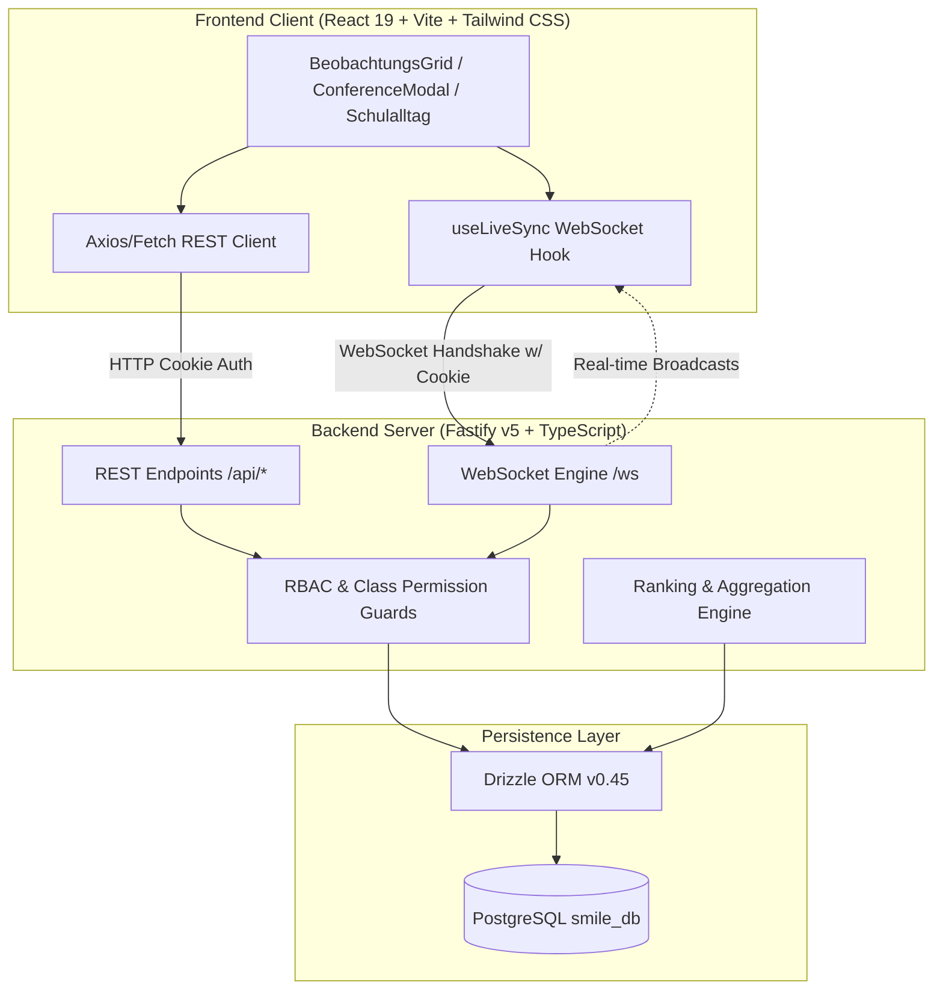

# SMILE Platform: Comprehensive Architecture & Code Review

> **Target Audience**: Senior Software Engineer / Coding AI Assessor  
> **Repository**: [damessner/SMILE](https://github.com/damessner/SMILE)  
> **Platform Version**: 2.0.0  
> **Last Audited & Updated**: October 6, 2026  
> **Deployment Target**: Proxmox VE 8.x LXC 115 (`http://172.16.1.11:3000/`), Host `172.16.1.54`

---

## 1. Executive Summary & Purpose

SMILE (**S**chüler-**M**atrix **I**nteraktives **L**ehrkraft-**E**valuationssystem) is a real-time collaborative grading, behavioral tracking, and conference decision-support platform designed for **MS Telfs Weissenbach** (an Austrian Middle School / Mittelschule).

### Core Educational Model
1. **Three Competency Stages**:
   - **Lehrling** (Apprentice): $< 8$ positive criteria items ($\le 7$).
   - **Geselle** (Journeyman): $8 - 13$ positive criteria items.
   - **Meister** (Master): $\ge 14$ positive criteria items (out of 18 total rubric items).
2. **Standard 18-Item Rubric**:
   - 6 Core Dimensions: *Organisation*, *Problemlösung*, *Verhalten & Kooperation*, *Verständnis*, *Haltung & Einsatz*, *Reflexion*.
   - Each dimension contains 3 items rated on a 4-level scale (`-`, `o`, `+`, `++`, or qualitative symbols `struggle`, `strain`, `smile`, `crown`).
3. **Behavioral Discipline & Escalation Loop**:
   - **Green Cards**: Positive acknowledgments.
   - **Yellow Cards**: Warnings. Accumulation of **3 Yellow Cards** across any subjects automatically triggers a school-wide conference alert for the student.
   - **Red Cards**: Severe infractions. Automatically applies a **demotion penalty** (demotes the conference proposal by 1 stage, e.g. *Meister* $\to$ *Geselle*, *Geselle* $\to$ *Lehrling*).
   - **Timeout (Lernwerkstatt - LW)**: Managed classroom timeout recording and resolution workflow.
4. **Timetable-Weighted Co-Teacher Voting**:
   - In Austrian Middle Schools, core subjects (**Deutsch [D]**, **Englisch [E]**, **Mathematik [M]**) are team-taught by two educators.
   - Non-core subjects (**Berufsorientierung [BO]**, **Physik [PH]**, **Musik [MUS]**, **Technik und Design [TUD]**, **Biologie [BUB]**, etc.) have 1–2 hours weekly.
   - Conference voting calculates weighted scores based on weekly lesson hours from WebUntis (`timetable_lessons`). Core subjects receive double weight to account for team-teaching balance.

---

## 2. System Architecture & Tech Stack



- **Runtime & Language**: Node.js $\ge 22.0.0$, TypeScript 5.7+ (ESM modules throughout).
- **Backend Framework**: Fastify v5 (`@fastify/cookie`, `@fastify/jwt`, `@fastify/websocket`, `@fastify/rate-limit`).
- **ORM & Database**: Drizzle ORM + PostgreSQL (`pg` driver with connection pooling via `getPool()`).
- **Frontend Framework**: React 19, TypeScript, Vite 8, Tailwind CSS, Lucide React icons.
- **Production Environment**: Proxmox LXC Container ID 115 (Debian 12), systemd unit `smile.service`, running on port 3000 behind reverse proxy / direct bridge.

---

## 3. Database Schema & Concurrency Model

All schema definitions reside in [`server/src/db/schema.ts`](file:///c:/Users/dames/OneDrive/Documents/antigravity/SMILE/server/src/db/schema.ts).

### Key Entities
| Table | Description | Natural / Unique Key |
| :--- | :--- | :--- |
| `school_classes` | Classes (1a, 2b, etc., plus virtual ID 999 'LW') | `id` (serial primary key) |
| `teachers` | Staff records with initials (`short_name`), emails | `short_name` (unique) |
| `pupils` | Enrolled pupils assigned to `class_id` | `id` (integer) |
| `teaching_assignments` | Maps teacher $\to$ class $\to$ subject (`subject_code`, `subject_name`) | `(teacher_id, class_id)` index |
| `timetable_lessons` | Lesson schedule parsed from WebUntis timetable export | `(teacher_id, class_id, subject_code)` |
| `observation_rounds` | Assessment periods (e.g. "Herbst 2026/27") | `id` (uuid) |
| `evaluations` | Overall evaluation per round, pupil, class, and subject | `(round_id, pupil_id, class_id, subject_code)` (UNIQUE) |
| `evaluation_items` | Individual rating per criterion item (18 per evaluation) | `(evaluation_id, item_key)` (UNIQUE) |
| `behavior_cards` | Discipline cards (`green`, `yellow`, `red`) with revocation timestamp | `id` (uuid) |
| `final_ranks` | Locked final conference grades voted by staff | `(round_id, pupil_id, class_id)` (UNIQUE) |
| `audit_logs` | Immutable operational audit trail | `id` (uuid) |

### Optimistic Concurrency Control (OCC)
In multi-teacher concurrent rating:
- Each row in `evaluation_items` maintains an integer `version`.
- Updates execute atomic database increments:
  ```sql
  UPDATE evaluation_items
     SET rating = $1, version = version + 1, updated_at = NOW()
   WHERE evaluation_id = $2 AND item_key = $3 AND version = $4;
  ```
- If another teacher saved in the interim ($version \neq expectedVersion$), the update returns 0 affected rows. The server queries the latest version and emits a `CONFLICT` WebSocket payload containing the name of the teacher who modified the cell.

---

## 4. Permission Guards & Access Matrix

Access controls are centralized in [`server/src/lib/guards.ts`](file:///c:/Users/dames/OneDrive/Documents/antigravity/SMILE/server/src/lib/guards.ts) via `getClassAccess(user, classId)`:

```typescript
export interface ClassAccess {
  exists: boolean;
  classId: number;
  isHeadmaster: boolean;  // Headmasters (e.g., MED, SLC)
  isKv: boolean;          // Homeroom Head (Klassenvorstand 1 or 2)
  teaches: boolean;       // Has teaching assignments in this class
  subjects: NormalizedSubject[]; // Resolved subjects for current teacher
  isCoreTeacher: boolean; // Teaches German, English, or Math in this class
  canRead: boolean;       // May view pupil roster and summaries
  canRate: boolean;       // May rate pupils in this class
  canRecord: boolean;     // May record behavior cards and timeout incidents
  canRunConference: boolean; // May open, vote, and finalize conference rankings
}
```

### Access Matrix Summary
- **Administrator / Headmasters**: Global access (`canRead: true`, `canRate: true`, `canRunConference: true`).
- **Homeroom Heads (KVs)**: Full access to their homeroom class, including running the conference and submitting final ranks.
- **Core Subject Teachers (D, M, E)**: Can view full observation raster, enter all 18 criteria items, submit ranking proposals for their subject.
- **Non-Core Subject Teachers (BO, PH, MUS, etc.)**: Can enter subject votes, overall status proposals, and comments; raster is collapsed by default but expandable on demand.

---

## 5. Critical Bugs Identified & Fixed in this Review

During this comprehensive code and live environment audit, four critical architectural and logic bugs were discovered and resolved:

### Bug 1: LiveSync Event Bus Black Hole
- **Symptom**: When a teacher submitted a pupil ranking, reopened a rating, issued a behavior card, or applied batch defaults, connected colleagues viewing the same class saw **no live updates**. A hard page reload was required.
- **Root Cause**: In [`client/src/hooks/useLiveSync.ts`](file:///c:/Users/dames/OneDrive/Documents/antigravity/SMILE/client/src/hooks/useLiveSync.ts), the WebSocket `onmessage` handler implemented `switch (msg.type)` but only had cases for `CELL_LOCKED`, `CELL_UNLOCKED`, `RATING_UPDATED`, `CONFLICT`, and `VOTING_LOCK_CHANGED`. It dropped `CARD_ISSUED`, `CARD_REVOKED`, `BATCH_ITEMS_UPDATED`, `BATCH_DEFAULTS_APPLIED`, `PUPIL_RANKING_SUBMITTED`, `PUPIL_RANKING_REOPENED`, `STATUS_UPDATED`, `TIMEOUT_CREATED`, `TIMEOUT_RESOLVED`, `FINAL_RANK_LOCKED`, and `FINAL_RANK_REVOKED` in `default: break;`.
- **Fix**: Added all broadcast types to `useLiveSync.ts` to trigger `onRatingUpdated?.(msg)`. In [`client/src/App.tsx`](file:///c:/Users/dames/OneDrive/Documents/antigravity/SMILE/client/src/App.tsx), `handleRatingUpdated` now triggers `loadClassData(selectedClassId)` to refresh state immediately, and re-fetches `getYellowCardAlerts()` whenever behavior cards change.

### Bug 2: Cross-Subject Submission Contamination
- **Symptom**: If an English teacher submitted an evaluation for a student, the student was marked as "already submitted" for the German and Math teachers as well, erroneously moving the pupil to the "Bewertet" (Submitted) tab.
- **Root Cause**: In [`client/src/components/BeobachtungsGrid.tsx`](file:///c:/Users/dames/OneDrive/Documents/antigravity/SMILE/client/src/components/BeobachtungsGrid.tsx):
  ```typescript
  // PREVIOUS FAULTY CODE:
  effectiveCanAccessRaster
    ? (e.subjectCode === mySubjectCode ? e.isSubmitted : e.isSubmitted)
    : (e.subjectCode === mySubjectCode && e.isSubmitted)
  ```
  Both branches of the inner ternary returned `e.isSubmitted`. Thus, if *any* evaluation on the student had `isSubmitted === true`, it evaluated to `true` for all subjects.
- **Fix**: Replaced with strict subject matching helper `isSubjectMatch(codeA, codeB)`. A student is now only treated as submitted for a subject if the evaluation matching that exact subject has `isSubmitted === true`.

### Bug 3: Subject Code Taxonomy Mismatch & Timetable Hours Disconnection
- **Symptom**: Timetable hours in `GET /api/classes` and conference weighting returned `hours: 0` for all non-core subjects (Berufsorientierung, Physik, Musik, etc.).
- **Root Cause**:
  1. `teaching_assignments` used administrative full names (e.g. `Berufsorientierung`, `Physik`, `Technik und Design`).
  2. `timetable_lessons` used WebUntis short codes (e.g. `BO`, `PH`, `TUD`).
  3. `server/src/utils/subject.ts` previously only mapped `D`, `M`, `E` and converted anything else to uppercase snake_case (`BERUFSORIENTIERUNG`).
  4. Lookup `teacherHoursMap.get("${classId}_BERUFSORIENTIERUNG")` searched for a key that did not match `timetable_lessons` (`"${classId}_BO"`).
  5. The database had inconsistent records stored under `SD`, `SMILE_ENGLISCH`, `BERUFSORIENTIERUNG`, `TECHNIK_UND_DESIGN`, etc.
- **Fix**:
  1. Rebuilt [`server/src/utils/subject.ts`](file:///c:/Users/dames/OneDrive/Documents/antigravity/SMILE/server/src/utils/subject.ts) with a comprehensive canonical mapping supporting both Austrian WebUntis short codes and full German subject names (`D`, `E`, `M`, `BO`, `PH`, `MUS`, `TUD`, `BUB`, `BS`, `CH`, `DIGGB`, `EH`, `GPB`, `GWB`, `GZ`, `ITAL`, `KUG`, `DAZ`, `RKATH`, `RISLA`, `REV`, `BFUD`, `BFUR`, `BFUM`, `BFUE`, `SL`, `ZI`, `LW`).
  2. Updated `server/src/routes/evaluations.ts` write routes (`/batch-default`, `/status`, `/submit`, `/reopen`, `/batch-items`) to canonicalize `subjectCode`.
  3. Ran safe SQL data harmonization on production `smile_db` updating legacy codes to canonical abbreviations (`D`, `E`, `M`, `BO`, `PH`, `MUS`, `TUD`, `GPB`, `GWB`, `BFUD`).
  4. Added timetable hours attachment to `GET /api/classes/:classId/pupils` in `server/src/routes/classes.ts`.

### Bug 4: Multi-Subject Positive Criteria Count Inflation in Preview
- **Symptom**: In the observation grid header, a student with ratings in multiple subjects (e.g., German and English) showed inflated positive criteria counts (e.g., "16/18 Kriterien positiv -> Meister"), even when only 8 items were positive in the currently displayed subject.
- **Root Cause**: `calculateRank` in `BeobachtungsGrid.tsx` used `pupil.evaluations.flatMap(e => e.items || [])`, aggregating items across all subjects.
- **Fix**: Re-scoped `calculateRank` to iterate over the 18 criteria items of the active rubric using `getItemData(pupil, it.key)`. The count is now strictly constrained to $0 - 18$ matching the displayed matrix.

---

## 6. Verification & Test Coverage Matrix

### Automated Test Suite
- Run command: `npm test` (`vitest run` in `server/`)
- **Status**: 123 tests passing across 9 test files (0 failures).
  - `src/utils/subject.test.ts` (5 tests) — canonical subject normalization
  - `src/lib/behavior-stages.test.ts` (14 tests) — behavior card thresholds & stages
  - `src/ws/live-sync.test.ts` (12 tests) — lock, rating, and concurrency broadcast
  - `src/lib/access-rules.test.ts` (6 tests) — class permission resolution
  - `src/lib/ranking.test.ts` (15 tests) — 18-item threshold scoring & card demotions
  - `src/config.test.ts` (8 tests) — environment validation
  - `src/lib/guards.test.ts` (13 tests) — authorization guards & KV privileges
  - `src/ws/auth.test.ts` (4 tests) — handshake authentication
  - `src/index.test.ts` (46 tests) — comprehensive route integration tests

### TypeScript Typecheck
- Run command: `npm run typecheck --workspaces`
- **Status**: Clean compilation with 0 errors across both `server` and `client`.

### Production Build & Live Container Status
- Built with `npm run build` (`tsc` on server, `tsc -b && vite build` on client).
- Deployed via `scripts/deploy_to_production.py` to Proxmox LXC 115.
- Health check: `GET http://172.16.1.11:3000/health` $\to$ `{"status":"ok","uptimeSeconds":30}`.

---

## 7. Guidelines & Inspection Points for the Next AI Reviewer

When continuing code inspection or developing future enhancements on SMILE, focus on these key files and architectural invariants:

1. **Subject Codes Invariant**:
   - Always route raw subject names or codes through `normalizeSubject(...)` from [`server/src/utils/subject.ts`](file:///c:/Users/dames/OneDrive/Documents/antigravity/SMILE/server/src/utils/subject.ts).
   - Never store full strings like `Berufsorientierung` or legacy `SD` in `evaluations.subject_code`. Always store canonical codes (`BO`, `D`, `E`, `M`, etc.).
2. **Evaluation Natural Key**:
   - Remember that `evaluations` has a unique constraint on `(round_id, pupil_id, class_id, subject_code)`. Concurrent inserts must use `onConflictDoUpdate` or catch unique violations to re-query the existing record.
3. **LiveSync Event Bus**:
   - Any new server event broadcast via `broadcastToClass(classId, msg)` must have a matching handler in [`client/src/hooks/useLiveSync.ts`](file:///c:/Users/dames/OneDrive/Documents/antigravity/SMILE/client/src/hooks/useLiveSync.ts) and [`client/src/App.tsx`](file:///c:/Users/dames/OneDrive/Documents/antigravity/SMILE/client/src/App.tsx).
4. **Conference Grade Calculation**:
   - Check [`server/src/routes/conferences.ts`](file:///c:/Users/dames/OneDrive/Documents/antigravity/SMILE/server/src/routes/conferences.ts) `calculateRank` and `demote`. The automatic proposal uses core subjects (`isCoreSmile`) for rubric thresholding, while non-core votes contribute to the hours-weighted consensus.
5. **Session Cookies & WebSocket Authentication**:
   - The platform uses HttpOnly SameSite session cookies. WebSocket handshakes do not accept token parameters in URLs; they rely strictly on the incoming HTTP cookie header during the upgrade handshake.
